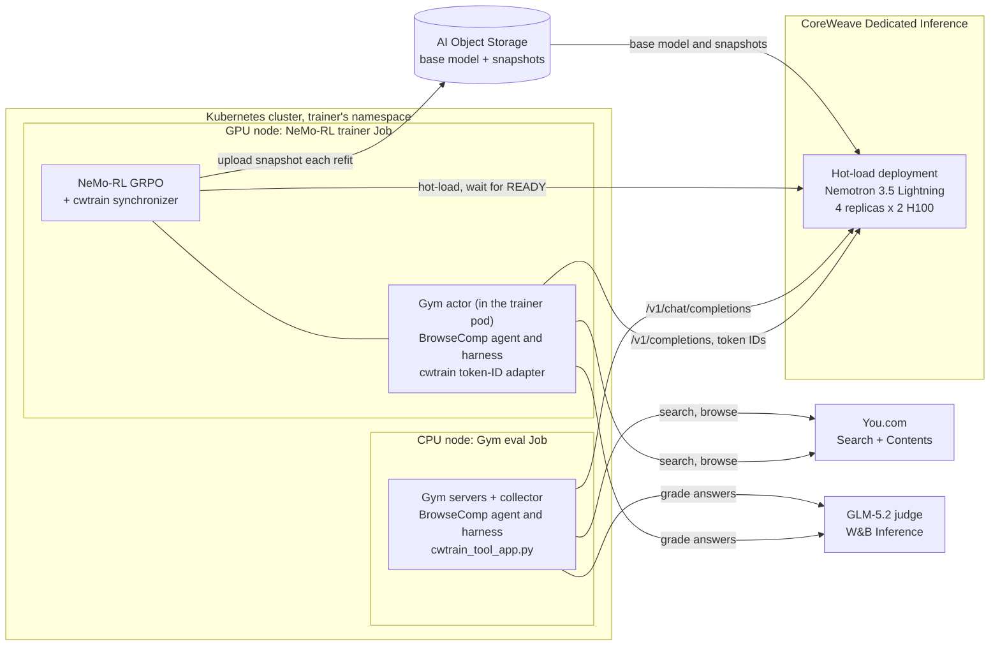

# Recipe: NeMo Gym evaluation on the NeMo-RL hot-load deployment

Evaluate the policy that the [NeMo-RL training recipe](../../../training/recipes/nemo-rl/README.md) serves,
with [NeMo Gym](https://github.com/NVIDIA-NeMo/Gym). The recipe reuses that recipe's hot-load
deployment. It creates no gateway, deployment or other inference resource, and it runs on CPU
only. By default it runs [BrowseComp](https://openai.com/index/browsecomp/) against
**Nemotron 3.5 Lightning 30B-A3B BF16**:

- Gym's BrowseComp agent searches and reads the web through You.com.
- An LLM judge, **GLM-5.2 on W&B Inference**, compares each final answer with the ground truth.

The evaluation runs as a Kubernetes Job on a CPU node, in the NeMo-RL trainer's namespace and
cluster. The pod runs the Gym servers (agent, tools and judge client) and the collector, and sends
model requests to the deployment's gateway. Gym's `vllm_model` adapter converts Gym's Responses
format into `/v1/chat/completions` requests. You do not need an inference engine or GPU.



Evaluate between training runs, not while the trainer Job refits the deployment
([When to evaluate](#when-to-evaluate)).

Three inputs change what runs. Set them in `eval.env` (the Job's settings) or pass them to
[`launch.py`](launch.py):

| `eval.env` | `launch.py` | Default | What it changes |
| --- | --- | --- | --- |
| `BENCHMARK` | `--benchmark` | `browsecomp` | The evaluation. BrowseComp is the only one; `launch.py`'s `BENCHMARKS` registry is where another Gym benchmark would go. |
| `ROLLOUT_MODEL` | `--model` | `nemotron-lightning-hotload` | The target model: the deployment's served model name. `nemotron-lightning-hotload` is Nemotron 3.5 Lightning on the NeMo-RL recipe's deployment. |
| `JUDGE_MODEL`, `JUDGE_BASE_URL` | `--judge-model`, `--judge-base-url` | `zai-org/GLM-5.2`, `https://api.inference.wandb.ai/v1` | The judge: any OpenAI-compatible endpoint and model. |

[`launch.py`](launch.py) uses the [cwtrain library](../../../libs/cwtrain/README.md)'s
`RolloutConfig` for the endpoint, model, key file and collection concurrency. For BrowseComp, it
copies this recipe's [`you_search.py`](you_search.py) into Gym's BrowseComp harness. It serves the
harness's `search` and `browse` tools from the You.com Search and Contents APIs, in place of
Tavily. The NeMo-RL example bundles the same file in its kit for search-agent training.
`YOU_SEARCH_MAX_CHARS`, when set, caps each result's page text and snippets to that many
characters; the evaluation keeps them whole.

Gym sends the chat requests, runs the agent and scores the answers. The recipe's
[`browsecomp.yaml`](browsecomp.yaml) overrides Gym's BrowseComp benchmark
config. [`exclude_domains.json`](exclude_domains.json) lists the sites that the search tools never
return, such as `huggingface.co`, which publishes the BrowseComp questions with their answers.

## Versions

| Component | Version |
| --- | --- |
| NeMo Gym | [`v0.6.0`](https://github.com/NVIDIA-NeMo/Gym/releases/tag/v0.6.0) |
| Deployment | The NeMo-RL recipe's hot-load deployment: `dynamo-vllm` `0.30.0+crwv.5`, `max-model-len` 32,768 |
| Model | `nvidia/NVIDIA-Nemotron-3.5-Lightning-30B-A3B-BF16`, served as `nemotron-lightning-hotload` |
| Judge | `zai-org/GLM-5.2` on [W&B Inference](https://docs.wandb.ai/inference/) (`https://api.inference.wandb.ai/v1`), CoreWeave's serverless inference |
| Search | You.com Search and Contents APIs (`https://ydc-index.io/v1`) |

The commands use the `gym` CLI from v0.6.0. The eval Job is validated on a CoreWeave Kubernetes
cluster against the NeMo-RL recipe's hot-load deployment (four replicas of two H100s): five
BrowseComp tasks, all graded.

## Prerequisites

- **The NeMo-RL recipe's hot-load deployment, READY.** Create it as
  [Creating the deployment](../../../training/recipes/nemo-rl/README.md#creating-the-deployment) describes.
  This recipe only sends it inference requests.
- The NeMo-RL trainer's cluster, with a CPU node (8 CPUs, 32 GiB) that can reach the deployment's
  gateway, the Gym repository and the judge and search APIs. `kubectl`, `envsubst` and `uv` on your
  machine.
- The NeMo-RL recipe's inference key Secret (`INFERENCE_KEY_SECRET`).
- For BrowseComp: the NeMo-RL example's judge and You.com key Secret (`GYM_SECRET`), with a
  [W&B API key](https://wandb.ai/authorize) for W&B Inference under `judge_api_key` and a
  [You.com API](https://you.com/platform) key under `search_api_key`. A judge on another endpoint
  takes its key the same way.

[`coreweave.yaml`](coreweave.yaml) turns off Nemotron thinking with `enable_thinking: false`. For
another model, remove or change `chat_template_kwargs` to match its template.

BrowseComp is long-horizon: each question can take many search and browse calls, and each final
answer is one judge call. Every task bills You.com and W&B Inference requests. Start with the default
`--limit 5`.

### When to evaluate

Each training refit hot-loads new weights into the deployment. Evaluate when no NeMo-RL trainer Job
is running against it: before training starts, or after the last step. Then every trajectory sees
the same weights, and the scores describe one policy version. `cwtrain hotload list --deployment
"$DEPLOYMENT_ID"` shows which version the deployment last loaded.

The deployment's replicas also serve the trainer's rollouts. An evaluation during training would
compete with them for the `autoscaling.concurrency` slots, as well as mix policy versions.

The example deployment runs four replicas of eight slots each, so up to 32 tasks run at once
(`CWTRAIN_ROLLOUT_CONCURRENCY`). Each BrowseComp turn also waits on a You.com call, and each answer
on a judge call. So raise the concurrency and `--limit` before you add replicas, and watch the
You.com and W&B Inference rate limits as concurrency grows.

## Run the evaluation on the cluster

Work in this recipe's `k8s/` directory with the kubectl context of the NeMo-RL trainer's cluster.
The Job reuses that recipe's namespace and Secrets: the inference key, and for BrowseComp the judge
and You.com keys ([Running it on Kubernetes](../../../training/recipes/nemo-rl/README.md#running-it-on-kubernetes),
steps 7, 9 and 10).

```bash
cd evaluation/recipes/nemo-gym/k8s
[ -e eval.env ] || cp eval.env.example eval.env   # once; copy the values from the NeMo-RL run.env
set -a; . ./eval.env; set +a
CTX=$(kubectl config current-context)
(cd ../../../../libs/cwtrain && uv build --wheel) && ./make-kit.sh "$CTX" "$NAMESPACE" "$EVAL_KIT_NAME"
../../../../k8s/render.sh eval.env eval-job.yaml | kubectl apply -f -
kubectl -n "$NAMESPACE" logs -f --pod-running-timeout=10m "job/cwtrain-gym-$EVAL_NAME"
```

The Job runs [`k8s/run-eval.sh`](k8s/run-eval.sh) on a node without GPUs. The script:

1. installs Gym `GYM_REF` (v0.6.0) and the cwtrain wheel in the pod,
2. for BrowseComp, downloads and decrypts the benchmark data: Gym v0.6.0's fixed 400-question
   subset of BrowseComp's 1,266 (seed 42),
3. starts the Gym servers with `launch.py start`. For BrowseComp, these are `policy_model`,
   `judge_model`, `browsecomp_benchmark_resources_server` and `browsecomp_benchmark_agent`,
4. collects `LIMIT` tasks (five by default) with `launch.py collect`, at `EVAL_CONCURRENCY` tasks in
   flight,
5. prints each task's reward and tool calls, and the mean reward.

The trajectories and Gym's metrics stay in the pod's `/work/results` until the Job is deleted. Use a
new `EVAL_NAME` for each evaluation. On a cluster that admits Jobs through Kueue, add the label
`kueue.x-k8s.io/queue-name: <local queue>` to the Job's metadata, as for the trainer Job.

### Eval time

Each task's time grows with its tool calls, and a hard BrowseComp question can take hundreds.
`MAX_STEPS` (`--max-steps`, default 50) caps the tool-calling turns per task; Gym's benchmark
allows 400. A task that reaches the cap is graded on the answer it gives then, usually none, so a
lower cap lowers the score as well as the time. `LIMIT` (`--limit`, default 5) sets how many tasks
run. They come from Gym v0.6.0's fixed 400-question subset in the same order, so scores from runs
with the same settings compare.

### Context length

BrowseComp allows 4,096 generated tokens per turn. Two settings bound a whole trajectory:

- `MAX_CONTEXT_TOKENS` (`--max-context-tokens`, default 32,768): the deployment's `max-model-len`.
- `--context-reset-tokens` (default half of `--max-context-tokens`): the prompt size at which the
  agent resets its context. It keeps the last rounds and its progress board, and drops older tool
  results. It must leave room for one more turn: at most `--max-context-tokens` minus 4,096.

Gym's benchmark config resets at 50,000 tokens, which suits its 196,608-token context. On a
32,768-token deployment, a request would overflow before that reset. So the launcher always sets
the reset point from these two flags.

### Tool calls

The hot-load deployment runs no tool-call parser, so `/v1/chat/completions` returns the model's
Qwen3-coder `<tool_call>` text as the message content. `launch.py start` copies cwtrain's
`gym_tool_calls` module into Gym's `vllm_model` server as `cwtrain_tool_app.py`, and
[`coreweave.yaml`](coreweave.yaml) makes it the policy model's entrypoint. It parses that text into
the message's tool calls, with each argument converted to its schema type, so the agent runs its
search and browse tools. The NeMo-RL training adapter uses the same parser.

### Verify

A completed run has one trajectory with a reward per task. For BrowseComp, a reward of 1 means that
the judge found the final `Exact Answer:` equivalent to the ground truth. A zero reward can mean a
wrong answer, or a trajectory that ran out of turns or context. It does not mean a connection
error. Read the tool calls and the
judge's response before you interpret the aggregate score.

## Stopping

The servers stop with the Job. Delete the Job and the kit when you are done:
`kubectl -n "$NAMESPACE" delete job "cwtrain-gym-$EVAL_NAME"` and
`kubectl -n "$NAMESPACE" delete configmap "$EVAL_KIT_NAME"`. The recipe created no inference
resources. The hot-load deployment belongs to the NeMo-RL recipe; remove it with
that recipe's [Cleaning up](../../../training/recipes/nemo-rl/README.md#cleaning-up) block when you no longer
need it.

## Why this is separate from NeMo-RL training

Gym supplies environments, agent execution and rewards. NeMo-RL supplies the optimizer and the
training loop. The [NeMo-RL recipe](../../../training/recipes/nemo-rl/README.md#training-environment)
trains the same agent on SimpleQA by default, with the same You.com tools and GLM-5.2 judge, and
this recipe scores it on BrowseComp.

This evaluation does not request training token metadata. So successful chat and reward collection
does not verify the training path, which requires exact token IDs and log-probs. See the training
recipe for the endpoint requirements and validation status.

Source references: [Gym v0.6.0 quickstart](https://github.com/NVIDIA-NeMo/Gym/blob/v0.6.0/README.md),
[HTTP model adapter](https://github.com/NVIDIA-NeMo/Gym/blob/v0.6.0/responses_api_models/vllm_model/app.py),
[NeMo-RL v0.7.0 GRPO setup](https://github.com/NVIDIA-NeMo/RL/blob/v0.7.0/nemo_rl/algorithms/grpo.py),
and [Gym integration design](https://github.com/NVIDIA-NeMo/RL/blob/v0.7.0/docs/design-docs/nemo-gym-integration.md).
