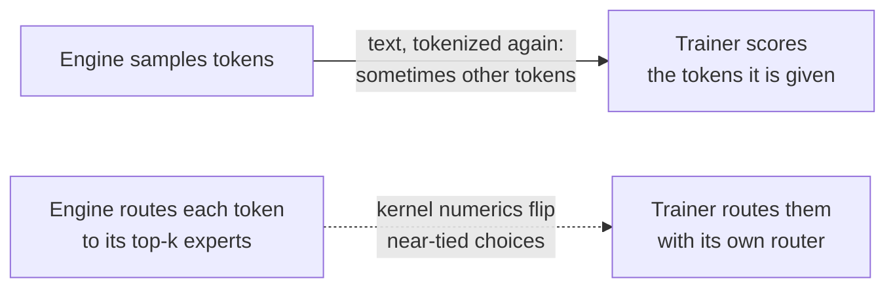
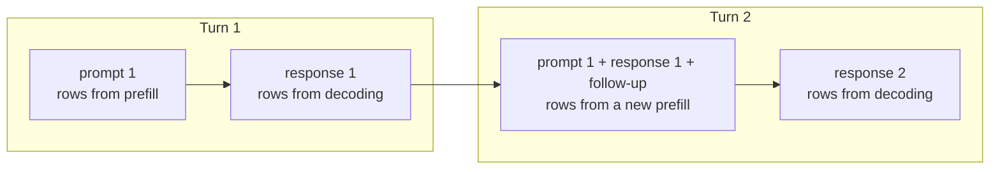
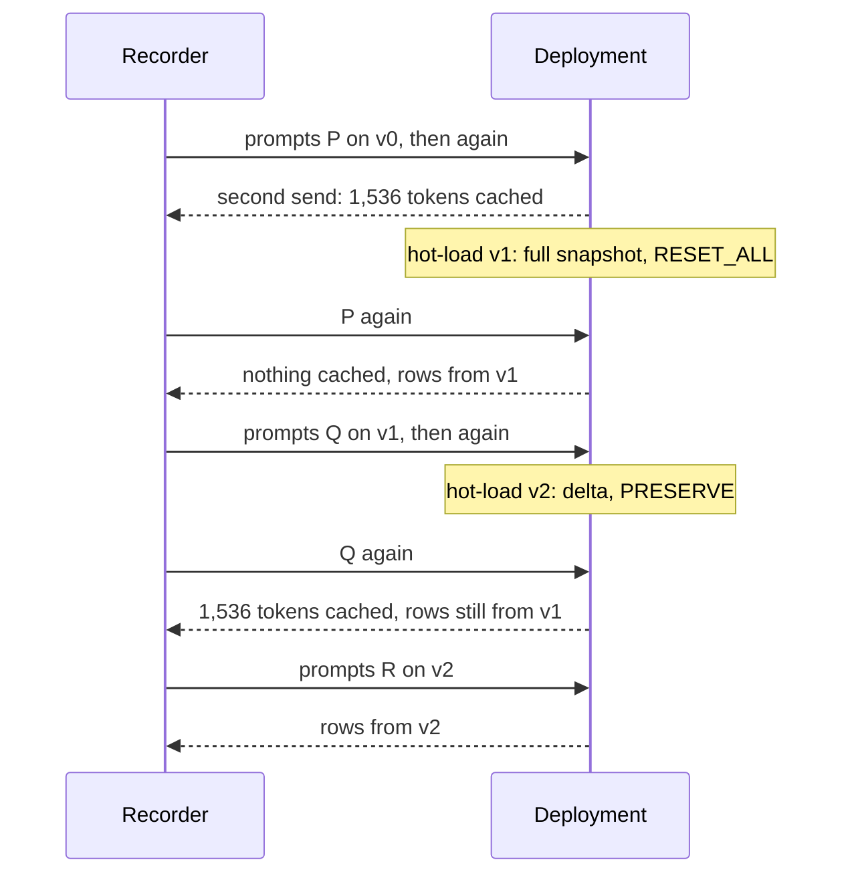

# Case study: rollout routing replay on an MoE model

A trainer's forward pass and the engine that sampled a rollout can disagree on **which tokens** the
trainer scores and, on a Mixture-of-Experts model, **which experts** each token goes through. Both
move the trainer's log-probs away from the engine's, and an RL loss then masks or clips tokens the
policy did sample. On GLM-5.3-Flash served by Dedicated Inference, token-in, token-out requests
close the first gap, and routing replay cuts the second 4.6×.



With routing replay, the engine returns the experts it chose for every token and layer, and the
trainer uses them instead of its own choices. The gate weights still come from the trainer's
router, so the router keeps learning. Replay needs exact tokens: the routes have one row per
position.

| | |
| --- | --- |
| Model | [`zai-org/GLM-5.3-Flash-BF16`](https://huggingface.co/zai-org/GLM-5.3-Flash-BF16) at `f9fed3bb`: 45 layers (42 MoE), 288 routed experts, top-8 |
| Deployment | `dynamo-vllm` 0.30, one replica of 16 H100 GPUs (tensor parallel 16), engine option `enable-return-routed-experts` |
| Rollouts | [`record.py`](record.py): 128 single-turn and 32 two-turn DAPO-Math-17k rollouts, temperature 1, at most 2,048 tokens |
| Trainer side | [`analyze.py`](analyze.py): transformers on 8 B200 GPUs, with its own routing and with the recorded routes replayed |

Up to 2,048 tokens the model's sparse attention selects every token, so transformers' dense
attention computes the same thing.

## Results

128 single-turn rollouts, 187,257 response tokens, 95% bootstrap intervals over sequences:

| | Sequences on other tokens | Routing choices that differ | Mean \|Δ log p\| | KL (k3) | Tokens outside [½, 2] |
| --- | --- | --- | --- | --- | --- |
| Text, tokenized again | 1 of 128 | — | — | — | — |
| Exact tokens | 0 | 44.4% | 0.0427 [0.0393, 0.0460] | 0.0067 | 857 (0.46%) |
| Exact tokens and replay | 0 | 0 | 0.0094 [0.0086, 0.0101] | 0.00036 | 1 |

- **Replay cuts the log-prob gap 4.6×** [4.4, 4.7] and the KL 19× [18, 20], and leaves 1 token for
  IcePop to mask or TIS to clip, against 857 without it.
- **Tokenizing the text again changes 1 of 128 responses** (4 of 128 in an earlier recording):
  splits the tokenizer doesn't produce (`-p` `refix` for `-prefix`, `BET` `WEEN` for `BETWEEN`),
  and a cut inside a multi-byte character. One kept its length, so a row-count check passes it and
  replay would put experts on the wrong tokens.

## Getting exact tokens and routes

cwtrain's sampler sends this with `CWTRAIN_ROLLOUT_ROUTED_EXPERTS=1`:

```json
{
  "model": "glm-5.3-flash",
  "prompt": [154822, 154824, 154826, 25062, "..."],
  "max_tokens": 1900,
  "temperature": 1.0,
  "top_p": 1.0,
  "logprobs": 1,
  "return_tokens_as_token_ids": true,
  "nvext": {"extra_fields": ["routed_experts"]}
}
```

- The sampled ids come back as `token_id:N` in `choices[0].logprobs.tokens`, the routes in
  `nvext.routed_experts`: base64, shape `[P + C − 1, layers, top_k]` for a P-token prompt and a
  C-token response, `uint16` above 256 experts. Row `i` routes the token at position `i`, the last
  sampled token has no row, and dense layers are zeros.
- **One choice per request**: with `n` > 1 there is only one set of routes. Streaming sends them once,
  at the end.
- **The rows belong to their sample.** Decoding on 16 GPUs isn't bit-exact: the same greedy prompt
  drifts after 70 to 120 tokens.
- **Engine builds.** Older vLLM builds lose routes under load and return all-zero rows on cache hits
  that end inside a block. vLLM 0.31 fixes both
  ([vllm-project/vllm#45635](https://github.com/vllm-project/vllm/pull/45635)).

[`probe.py`](probe.py) checks all of this on a deployment, both engine bugs included, and that the
rows of a decoded response match a prefill of the same tokens. Every check passed on this one.

## Multi-turn

Build turn 2 from turn 1's exact ids, without a trailing stop token, and the rendered follow-up
(`second_turn_prompt` in [`record.py`](record.py)). Rendering the whole conversation from text changed **21 of 25**
conversations whose first turn was cut off, and 0 of 7 complete ones.

The prefix cache keeps 384-token blocks of prompts, never generated tokens, so turn 2 recomputes
turn 1's positions, and **only 57% of those rows match turn 1's**:



| Routes replayed, one pass over the conversation | Turn-1 tokens | Turn-2 tokens |
| --- | --- | --- |
| None | 0.0402 | 0.0348 |
| Turn 2's rows everywhere | 0.0379 | 0.0084 |
| Each turn's rows over its own positions | 0.0086 | 0.0136 |

**Train each turn as its own sample with that turn's routes**, and both gaps stay at the
single-turn level.

## Routes across a hot-load

Two versions stand in for training steps, with seeded noise on the routers
([`router_noise.py`](router_noise.py)). The noise is 0.5% of each router's RMS; it flips 4% of
routing choices directly and about half after later layers. v1 goes out as a full snapshot with
`RESET_ALL`, v2 as a 37 MB delta with `PRESERVE`:



No router runs before the first MoE layer, so its router sees the same input under every version.
Where two versions choose differently there (1,260 to 1,360 tokens per set), the returned row shows
which one computed it:

| Set (16 prompts of 1,538 tokens) | Cached prompt tokens | The row matches |
| --- | --- | --- |
| P on v0 | 0 | v0 54%, v1 33% |
| P after v1 (`RESET_ALL`) | 0 | v1 53%, v0 33% |
| Q after v2 (`PRESERVE`) | 1,536, rows byte-identical to v1's | **v1 53%, v2 35%** |
| R on v2 | 0 | v2 55%, v1 31% |

With `PRESERVE`, a cached prompt keeps the previous version's KV cache and routes. The synchronous
recipes (slime, miles `train.py`, NeMo-RL, Axolotl) publish with `RESET_ALL`; miles' `train_async.py`
keeps `PRESERVE`.

## Using the routes

- **slime and miles**: `--use-rollout-routing-replay` makes cwtrain's rollout function ask for the
  routes and pass them on as `rollout_routed_experts`. See the
  [miles](../../recipes/miles/README.md#routing-replay-for-moe-models) and
  [slime](../../recipes/slime/README.md#routing-replay-for-moe-models) recipes.
- **Your own trainer**: replace each MoE layer's top-k choice with the recorded row, and compute the
  gate weights from your router's scores at those experts. For GLM's sigmoid router, renormalize
  them over the replayed experts and multiply by the routed scaling factor. `Routing` in
  `analyze.py` does it with a forward hook.

## Limitations

- **Payload**: 2 bytes × layers × top-k per token, 720 bytes here. A 16,384-token response is
  17.4 MiB, 11.3 MiB of it routes.
- **One model, one recording.** Transformers stands in for a trainer's kernels.
- **Up to 2,048 tokens.** Longer sequences need a trainer that implements the sparse attention
  layers.
- **Replay removes only the routing part of the gap.** The rest, 0.0094 here, is left to an
  off-policy correction such as TIS, which the slime, miles and NeMo-RL recipes turn on.

## Reproduce

[`reproduce.sh`](reproduce.sh) runs every step against your deployment. Its header lists what it
needs: disk, the deployment's bucket credentials, and GPUs for the trainer-side passes
(`FORWARD=1`). It checks the token, the bucket and the credentials before the first step, and
refuses a `WORK` directory that already holds a recording.

```bash
pip install -e libs/cwtrain transformers huggingface_hub jinja2
export CWTRAIN_ROLLOUT_BASE_URL="https://YOUR-GATEWAY/v1" CWTRAIN_ROLLOUT_API_KEY="YOUR-API-KEY"
export COREWEAVE_API_TOKEN="YOUR-API-TOKEN" DEPLOYMENT_ID="YOUR-DEPLOYMENT-ID"
export AWS_ACCESS_KEY_ID="YOUR-KEY-ID" AWS_SECRET_ACCESS_KEY="YOUR-SECRET" AWS_REGION="BUCKET-ZONE"
training/case-studies/rollout-routing-replay/reproduce.sh
```
