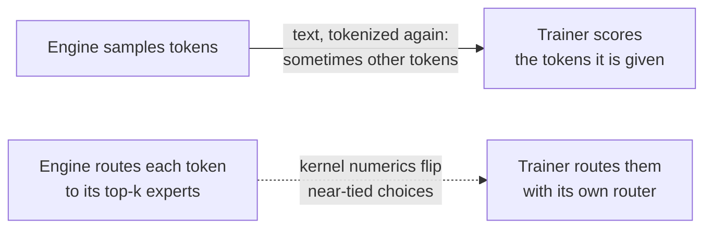
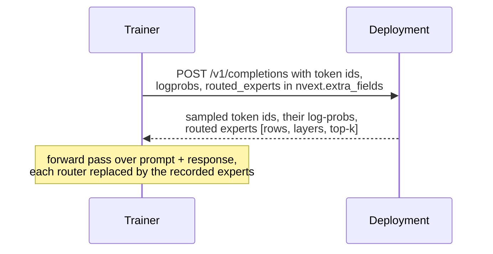
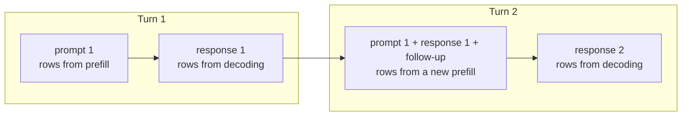
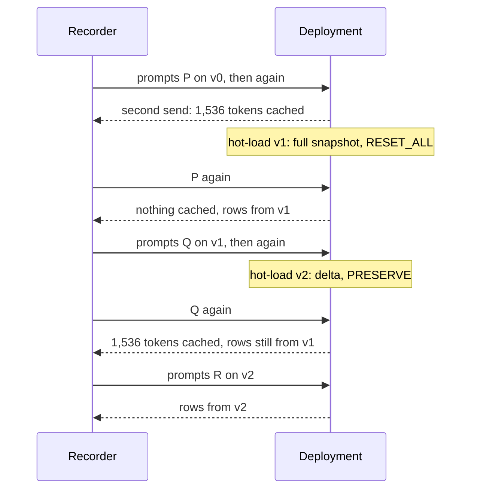

# Case study: exact tokens and routing replay for MoE rollouts

On a Mixture-of-Experts model, the trainer's forward pass and the engine that sampled a rollout can
disagree in two ways: **which tokens** the trainer scores, and **which experts** each token goes
through. Both move the trainer's log-probs away from the engine's, and an RL loss then masks or
clips tokens that the policy did sample. This study measures both on GLM-5.3-Flash served by a
Dedicated Inference deployment, and removes them: token-in, token-out requests fix the tokens, and
routing replay fixes the experts.



Exact tokens close the first gap: send token ids and get the sampled ids back. Routing replay closes
the second: the engine returns the experts it chose for every token and layer, and the trainer uses
them instead of its own choices. The gate weights still come from the trainer's router, so the
router keeps learning. Replay needs exact tokens, because the routes have one row per position.

## Setup

| | |
| --- | --- |
| Model | [`zai-org/GLM-5.3-Flash-BF16`](https://huggingface.co/zai-org/GLM-5.3-Flash-BF16) at `f9fed3bb`: 45 layers, 3 dense and 42 MoE, 288 routed experts, top-8 |
| Deployment | `dynamo-vllm` 0.30, one replica of 16 H100 GPUs (tensor parallel 16), engine option `enable-return-routed-experts` |
| Recording | [`record.py`](record.py): 128 single-turn rollouts and 32 two-turn conversations on DAPO-Math-17k prompts, temperature 1, at most 2,048 tokens each; three sets of 16 long prompts for the hot-load part |
| Trainer side | [`analyze.py`](analyze.py): Hugging Face transformers 5.20.2 on 8 B200 GPUs, once with its own routing and once with the recorded routes replayed |



The 2,048-token limit keeps the trainer exact: up to 2,048 tokens, the model's sparse attention
layers select every token, so the dense attention in transformers computes the same thing.

## Getting exact tokens and routes

The request is what cwtrain's sampler sends with `CWTRAIN_ROLLOUT_ROUTED_EXPERTS=1`:

```json
{
  "model": "glm-5.3-flash",
  "prompt": [154822, 154824, 154826, 25062, "..."],
  "max_tokens": 1900,
  "temperature": 1.0,
  "top_p": 1.0,
  "logprobs": 1,
  "return_tokens_as_token_ids": true,
  "nvext": {"extra_fields": ["routed_experts"]}
}
```

The sampled ids come back as `token_id:N` strings in `choices[0].logprobs.tokens`, and the routes
in `nvext.routed_experts`: `{"data": <base64>, "shape": [rows, layers, top_k], "dtype": "uint16",
"start": 0}`. `cwtrain.integrations.rollout.decode_routed_experts` turns them into an array.

| Position | 0 … P − 1 | P … P + C − 2 | P + C − 1 |
| --- | --- | --- | --- |
| Token | prompt | response, all but the last | last response token |
| Row of routes | computed in prefill | computed while decoding | none: it was sampled, never fed |

- **One row per position but the last**: P + C − 1 rows for a P-token prompt and a C-token response.
  Rows of dense layers are zeros. The ids are `uint8` up to 256 experts and `uint16` above.
- **One choice per request.** With `n` > 1, the response carries one set of routes for all
  choices. cwtrain sends a GRPO group as `n` requests.
- **Streaming** sends the routes once, in one of the stream's last events.
- **Size.** GLM-5.3-Flash's routes are 720 bytes per token. A 16,384-token response is 17.4 MiB,
  11.3 MiB of it routes.
- **The rows belong to that sample only.** Decoding on 16 GPUs is not bit-exact from run to run:
  the same prompt, decoded greedily twice, gives the same tokens for 70 to 120 tokens, with only
  60–70% of their routing choices the same.

[`probe.py`](probe.py) checks a deployment before you rely on it: row counts and shapes, repeated
and cached prompts, 64 concurrent requests, `n=2`, streaming, chat and a long response. Every check
passed on the deployment above.

## What each step closes

128 single-turn rollouts, 191,334 response tokens, with 95% bootstrap intervals over sequences.
The first row counts only the sequences that change; the others score as in the second row.

| Step | Sequences on other tokens | Routing choices that differ | Mean \|Δ log p\| | KL (k3) | Tokens outside [½, 2] |
| --- | --- | --- | --- | --- | --- |
| Text, tokenized again | 4 of 128 | — | — | — | — |
| Exact tokens | 0 | 44.2% [43.5, 45.0] | 0.0427 [0.0392, 0.0463] | 0.0068 | 821 (0.43%) |
| Exact tokens and replay | 0 | 0 (replayed) | 0.0095 [0.0088, 0.0103] | 0.00036 | 0 |

- **Replay cuts the mean log-prob gap 4.5×** [4.4, 4.6] and the KL 19× [17, 20].
- **No token's probability ratio leaves [½, 2] with replay.** Without it, 821 tokens do. IcePop
  masks those tokens and TIS truncates their weights, although the policy sampled them.
- **Routing differs at 44% of (token, MoE layer) choices** without replay, and almost every token
  (99.98%) has at least one layer that differs. GLM-5.3-Flash's sigmoid router over 288 experts has
  many near-ties, and kernel numerics break them differently in the engine and in the trainer.
- **Tokenizing the text again changes 4 of 128 responses.** The model sampled a split that the
  tokenizer doesn't produce (`$k` for `$`, `k`; `BET` `WEEN` for `BETWEEN`), or a truncated response
  ends inside a multi-byte character. One keeps its length, so a row-count check misses it, and
  replay would put experts on the wrong tokens.

## Multi-turn

Build each turn's prompt from the previous turn's exact ids, then render only the new message.
[`record.py`](record.py) does it in `second_turn_prompt`:

```python
prompt2 = prompt1 + response1_ids + follow_up_suffix  # no re-rendering of turn 1
```

Rendering the whole conversation from text instead changes **21 of 25** conversations whose first
turn was cut off at the token limit, because the chat template can't represent an unfinished
thought, and **0 of 7** complete ones.

The routes need a choice too. The deployment caches whole 384-token blocks of prompts and never
generated tokens, so here the second turn recomputes every position of the first. **Only 56–59% of
those rows match the first turn's**:



A trainer that scores the whole conversation in one pass sees different gaps depending on which
rows it replays (mean |Δ log p|, 32 conversations):

| Routes replayed | Turn-1 tokens | Turn-2 tokens |
| --- | --- | --- |
| None (the trainer's own) | 0.0426 | 0.0412 |
| Turn 2's rows for every position | 0.0422 | 0.0103 |
| Each turn's rows for its own positions | 0.0093 | 0.0158 |

Turn 2's rows fit turn 2's tokens but don't help turn 1's: those were sampled with turn 1's
routing. Turn 1's rows fit turn 1's tokens, but turn 2's tokens were computed on top of the new
prefill. **Train each turn as its own sample with that turn's routes**, and both gaps stay at the
single-turn level.

## Routes across a hot-load

A hot-load swaps the weights under a running deployment. Its prompt cache policy decides what a
cached prompt returns afterwards: `RESET_ALL` drops the cache, and `PRESERVE` (the default) keeps
it. Two versions stand in for training steps, each with seeded noise on the routers
([`router_noise.py`](router_noise.py)): v1, published as a full snapshot with `RESET_ALL`, and v2,
published as a 37 MB delta with `PRESERVE`. The noise is 0.5% of each router's RMS. It changes 4%
of routing choices directly and about half of them once later layers see the changes.



Each set has 16 prompts of 1,538 tokens; 1,536 of them fill four of the cache's 384-token blocks.
To tell which weights computed a row, the trainer routes every prompt under each version. The first
MoE layer's router sees the same input under every version, since no router comes before it, so
where two versions choose differently there, the returned row shows which one the engine ran:

| Set | Sent | Cached prompt tokens | Where the two versions differ, the row matches |
| --- | --- | --- | --- |
| P | on v0, then again | 0, then 1,536, rows byte-identical | v0 53%, v1 33% |
| P | after v1 (`RESET_ALL`) | 0 | v1 54%, v0 33% |
| Q | on v1, then again | 0, then 1,536, rows byte-identical | v1 54%, v2 32% |
| Q | after v2 (`PRESERVE`) | **1,536, rows byte-identical to v1's** | **v1 54%, v2 32%** |
| R | on v2 | 0 | v2 55%, v1 30% |

Each share is over 1,260 to 1,360 tokens; the rest of the rows match neither version, because the
engine's kernels differ from the trainer's.

- **`RESET_ALL`** drops the cache: P was cached just before the hot-load and got no hit after it,
  and its rows follow v1.
- **`PRESERVE`** keeps it: Q's cached prompt comes back with v1's KV cache and v1's routes while
  the deployment serves v2. Neither replay nor the trainer's own routing reproduces that prompt
  under v2's weights. The cookbook's synchronous recipes (slime, miles `train.py`, NeMo-RL and
  Axolotl) publish with `RESET_ALL` unless you set otherwise. miles' `train_async.py` keeps
  `PRESERVE`, so its prompt rows come from whichever version cached the prompt.

## Using tokens and routes in a trainer

- **slime and miles**: `--use-rollout-routing-replay` makes cwtrain's rollout function ask for the
  routes and hand them to the trainer as `rollout_routed_experts`. See the
  [miles](../../recipes/miles/README.md#routing-replay-for-moe-models) and
  [slime](../../recipes/slime/README.md#routing-replay-for-moe-models) recipes.
- **Your own trainer**: replace each MoE layer's top-k choice with row `i`, layer `l` of the routes,
  and compute the gate weights from your router's scores at those experts. For a sigmoid router
  like GLM's, that is the scores renormalized over the replayed experts, times the routed scaling
  factor. `analyze.py` does it with a forward hook in `Routing`.

## Cost and limitations

- **Payload**: 2 bytes × layers × top-k per token. Sending routes for rollouts of 32,768 tokens on
  this model adds about 31 MB of base64 per response.
- **Compute**: replay adds none; the trainer computes the same gates over other experts.
- **One model, one recording.** Transformers stands in for a trainer's kernels: Megatron's kernels
  differ from it and from the engine in other ways.
- **2,048 tokens.** Longer sequences need a trainer that implements the sparse attention layers.
- Replay doesn't replace off-policy corrections such as TIS: it removes the routing part of the gap,
  and the rest (about 0.0095 here) remains.

## Reproduce

From a checkout of this repository, against a deployment with `enable-return-routed-experts` and a
hot-load prefix, with its bucket's credentials set as for the recipes. Fill in the first four lines;
`v0` is the local copy of the served weights that the noise versions start from.

```bash
export CWTRAIN_ROLLOUT_BASE_URL="https://YOUR-GATEWAY/v1" CWTRAIN_ROLLOUT_MODEL="glm-5.3-flash"
export CWTRAIN_ROLLOUT_API_KEY="YOUR-API-KEY" COREWEAVE_API_TOKEN="YOUR-API-TOKEN"
DEPLOYMENT="YOUR-DEPLOYMENT-ID"
M="zai-org/GLM-5.3-Flash-BF16"
pip install -e libs/cwtrain transformers huggingface_hub jinja2
cd training/case-studies/rollout-routing-replay
hf download "$M" --revision f9fed3bbc82291073373d67452e9f25317ef7577 --local-dir v0
python probe.py --model-path "$M"
python record.py --model-path "$M" --out recording --version v0 --sets P,single,two_turn
python record.py --model-path "$M" --out recording --version v0-resend --sets P
python router_noise.py --base v0 --out v1 --seed 1 --scale 0.005
cwtrain hotload publish --deployment "$DEPLOYMENT" --checkpoint v1 --identity v1 --reset-prompt-cache
python record.py --model-path "$M" --out recording --version v1 --sets P,Q
python record.py --model-path "$M" --out recording --version v1-resend --sets Q
python router_noise.py --base v1 --out v2 --seed 2 --scale 0.005 --delta v2-delta
cwtrain hotload publish --deployment "$DEPLOYMENT" --checkpoint v2-delta --identity v2
python record.py --model-path "$M" --out recording --version v2 --sets Q,R
cp v1.noise.json recording/v1/router_noise.json
cp v2.noise.json recording/v2/router_noise.json
python analyze.py --recording recording --model-path "$M" --forward --out report.json
```

`analyze.py --forward` needs about 640 GB of GPU memory for the BF16 weights, and
`flash-linear-attention` for the model's linear attention layers.
