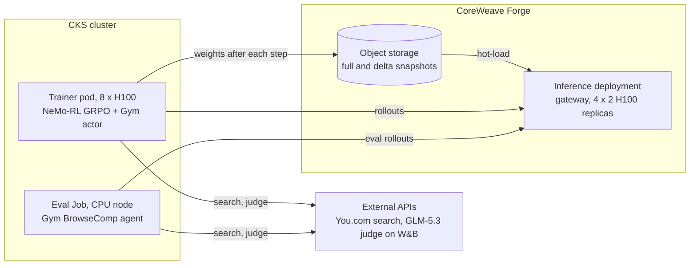

# Case study: training a web search agent with NeMo-RL on Dedicated Inference

This study trains Nemotron 3.5 Lightning (30B-A3B, BF16) to answer questions by searching the web,
and measures it on BrowseComp. It runs the [NeMo-RL recipe](../../recipes/nemo-rl/README.md) as it
is: GRPO with rollouts from a Dedicated Inference deployment, and every refit hot-loaded into it.
The study brings its own environment through the recipe's settings: a config,
[`grpo_search_agent.yaml`](grpo_search_agent.yaml), which inherits the recipe's
[`grpo_coreweave.yaml`](../../recipes/nemo-rl/grpo_coreweave.yaml), a data script and the keys.
Its [evaluation](#evaluation) then runs Gym's BrowseComp benchmark on a CPU node against the same
deployment.

## The problem

A search agent answers a question in turns: it searches, reads pages, and states an answer. Each
turn is a model call, so a training step needs many long rollouts, and every rollout must come
from the current weights. Here, a Dedicated Inference deployment serves the rollouts, and cwtrain
hot-loads the trainer's weights into every replica between steps, so the trainer runs no inference
engine of its own.

## Data

- **Training**: a random sample of
  [ASearcher-Base-35k](https://huggingface.co/datasets/inclusionAI/ASearcher-train-data)
  (Apache-2.0, 29,853 usable English questions that take 2 to 4 hops over Wikipedia), which
  [`prepare_search_data.py`](prepare_search_data.py) downloads before training.
- **Evaluation**: OpenAI's [BrowseComp](https://openai.com/index/browsecomp/) (1,266 questions
  that take tens to hundreds of tool calls). It is too hard to train on at this trajectory length:
  every reward is 0, so a step learns nothing.

No ASearcher-Base question is a BrowseComp question, so the trained model can still be evaluated on
BrowseComp. BrowseComp is a public test set with no train split.

## Setup



After each GRPO step, cwtrain uploads the weights (a full snapshot or a delta) and hot-loads them
into every replica before the next rollouts. The trainer's Gym actor and the evaluation's agent
sample from the same deployment and call the same search and judge APIs.

| | |
| --- | --- |
| Training recipe | [NeMo-RL](../../recipes/nemo-rl/README.md): synchronous GRPO with the DTensor (Automodel) policy backend |
| Model | [`nvidia/NVIDIA-Nemotron-3.5-Lightning-30B-A3B-BF16`](https://huggingface.co/nvidia/NVIDIA-Nemotron-3.5-Lightning-30B-A3B-BF16), at the commit that `HF_REVISION` pins, without its MTP heads ([`prepare_model.py`](../../recipes/nemo-rl/prepare_model.py), which the staging Job runs) |
| Data | [ASearcher-Base-35k](https://huggingface.co/datasets/inclusionAI/ASearcher-train-data) questions, sampled at random by [`prepare_search_data.py`](prepare_search_data.py) before training |
| Environment and reward | Gym's BrowseComp agent with You.com `search` and `browse` tools; an LLM judge (`zai-org/GLM-5.3` on W&B Inference) grades each final answer |
| Trainer | 8 GPUs of a `gd-8xh100ib-i128` node, eight-way expert parallelism; 30 GRPO steps (`NUM_STEPS`) of 8 prompts × 4 generations |
| Evaluation | [NeMo Gym](https://github.com/NVIDIA-NeMo/Gym) v0.7.0's BrowseComp benchmark on a CPU node, against the same deployment ([Evaluation](#evaluation)) |
| Deployment | [`deployment.example.json`](deployment.example.json): `dynamo-vllm`, 4 replicas of 2 H100 GPUs each, `autoscaling.concurrency` 8, `max-model-len` 32,768 |

## Results

One run (n = 1, so no spread yet), on 2026-11-04: three GRPO steps of 8 ASearcher-Base questions
× 4 trajectories each, from 256 sampled at random (`--sample 256`, `NUM_STEPS=3`). The trainer was
one 8×H100 node in a CoreWeave Kubernetes cluster in US-EAST-06A, and the deployment was 4
replicas of 2 H100s in US-WEST-04A.

| Step | Avg reward | Loss | Step time | Hot-load before the step |
| --- | --- | --- | --- | --- |
| 1 | 0.25 | −0.033 | 407 s | v0 full snapshot (58.3 s upload): 81.2 s to 4/4 replicas |
| 2 | 0.28 | 0.012 | 274 s | v1 delta (1.3 s upload): 89.5 s to 4/4 replicas |
| 3 | 0.19 | −0.046 | 242 s | v2 delta (1.3 s upload): 65.2 s to 4/4 replicas |

Every step had a non-zero loss, so groups had mixed rewards and GRPO had something to learn from.
In step 1, 2 of the 8 groups were mixed, 1 was all correct and 5 were all wrong. Of the 96
trajectories, 49 used all 12 turns, most of them without a final answer. The rewards over three
steps measure nothing about learning; they show the loop works. The trainer exited 0. This run's
policy was not evaluated.

## Cost

The run above used:

- Trainer: 8 H100s for 41 minutes (model download, setup and three steps), about 5.5 GPU-hours.
- Deployment: 8 H100s from creation until deletion. Most of that waits for the trainer's node to
  be provisioned and set up; the three steps took 15 minutes.
- APIs: 100 judge calls to `zai-org/GLM-5.3` on W&B Inference (96 verdicts and 4 retries), and
  1,143 You.com search and contents calls (at most 12 per trajectory).

## Limitations

- One short run: three steps and five eval tasks. It shows the loop and its hot-loads working, not
  a better model. Measure an improvement with more steps, more eval tasks and several runs.
- The 16,384-token trajectory and 12 tool turns fit the 8×H100 trainer, but most BrowseComp
  questions need more, so BrowseComp is the evaluation, not the training set.
- ASearcher-Base records no difficulty, so the reward level depends on the sample. Check the first
  steps' rewards before a long run.
- The search tools drop pages that name the datasets, and the judge grades only the final
  answer ([Guarding the reward](#guarding-the-reward)). Neither stops a page that quotes a question
  without naming its dataset.
- Web search results change over time, so runs are not exactly repeatable.

## What you need

Follow the Dedicated Inference
[getting-started guide](https://docs.coreweave.com/products/inference/getting-started) for the
account prerequisites, the gateway and the bucket policy. Then get these:

- **A hot-load-enabled deployment** (engine `dynamo-vllm`, with a `hotLoad` section). Use
  [`deployment.example.json`](deployment.example.json) and see
  [Creating the deployment](#creating-the-deployment). The prerequisites are in the
  [library README](../../../libs/cwtrain/README.md#prerequisites). CoreWeave enables hot-load per
  organization. To enable it, ask CoreWeave support and give your organization ID. Until then, the
  create fails with `hot-load is not enabled for this organization`. The
  [RL Rollouts docs](https://docs.coreweave.com/products/inference/rl-rollouts) describe the
  feature. The deployment's `autoscaling.concurrency` limits how many sequences each replica
  decodes at once. See [Concurrency](#concurrency).
- **A bucket that the inference service can read and the trainer can write.**
  [`bucket-policy.example.json`](../../../k8s/bucket-policy.example.json) has four statements. The
  first two are from the docs'
  [Grant inference access to your bucket](https://docs.coreweave.com/products/inference/models#grant-inference-access-to-your-bucket):
  `AllowInference` lets the canonical inference service account read, and `AllowOrgUsers` lets
  your org read. **Any attached policy makes the bucket explicit-allow only, so do not remove the
  org statement.** The other two statements name the trainer and the admin:
  - `AllowTrainer` lets the trainer add objects under the deployment's hot-load prefix, and nowhere
    else. It cannot delete objects or change the policy.
  - `AllowAdmin` lets your admin user stage the base model, and delete objects when you clean up.

  To apply the policy:
  1. Copy it to `k8s/bucket-policy.run.json` in this study's directory (git-ignored, like
     `deployment.run.json`).
  2. Fill in `[BUCKET-NAME]`, `[ORG-ID]`, `[HOT-LOAD-PREFIX]` (the deployment's
     `hotLoad.pathPrefix`, `hotload` in every example) and `[ADMIN-USER-ID]`, which is on the
     admin's Cloud Console Settings page. Fill in the trainer's principal as the next item
     describes.
  3. From this directory, with the admin's credentials, run `aws s3api put-bucket-policy --bucket
     <bucket> --policy file://k8s/bucket-policy.run.json --endpoint-url https://cwobject.com
     --region <bucket zone>`.

  If your credentials are in the cluster, [`make-bucket-job.yaml`](../../../k8s/make-bucket-job.yaml)
  can create the bucket and attach the same policy instead. It fills in the template from the kit
  ConfigMap with the values in `run.env`. Running it again keeps the policy's other statements, and
  keeps the trainers and admins that an earlier run added.
- **A principal of its own for the trainer.** A request needs an allow from both your org access
  policies and the bucket policy. But `s3:PutBucketPolicy` is checked against org access policies
  only, so if the trainer shared the admin's principal, it could replace the bucket policy. We
  recommend that the trainer Job run as a Kubernetes service account with
  [Workload Identity Federation](https://docs.coreweave.com/security/tutorials/cks-object-storage-authentication/manual).
  The pod exchanges the service account's token for temporary credentials, so no long-lived key
  sits in the cluster. This needs:
  1. The cluster's OIDC issuer, registered on the Cloud Console's **Workload Federation** page with
     the audience `https://coreweave.com/iam`. This needs the IAM Admin role. The issuer URL is on
     the cluster's page in the Cloud Console.
  2. An org access policy for the service account. Copy
     [`trainer-access-policy.example.json`](../../../k8s/trainer-access-policy.example.json) to
     `k8s/trainer-access-policy.run.json` in this study's directory (git-ignored), fill it in, and
     apply it from this directory with
     `cwic cwobject policy create --file k8s/trainer-access-policy.run.json`. It allows the token
     exchange, reading the bucket, and `s3:PutObject` and `s3:AbortMultipartUpload` under the
     hot-load prefix, and nothing else.
  3. In `AllowTrainer`, the issuer URL for `[OIDC-ISSUER-URL]`, and `NAMESPACE` and
     `TRAINER_SERVICE_ACCOUNT` from `run.env` for `[NAMESPACE]` and `[SERVICE-ACCOUNT]`.

  To use a Cloud Console user's key instead, give the trainer a user of its own, and set
  `AllowTrainer`'s principal to `{"CW": ["arn:aws:iam::[ORG-ID]:coreweave/[TRAINER-USER-ID]"]}`
  (see `run.env.example`). To try the study on your own, you can name your own user in both
  statements, but the trainer's key then has all of your rights; the bucket Job warns about this.
  At start, the trainer Job checks that its credentials can list, read and write under the
  hot-load prefix, and it stops if they cannot.
- **Object storage credentials.** The trainer Job mounts `STORAGE_SECRET`: with Workload Identity
  Federation, it holds no key; otherwise, the trainer's key. The Jobs that create the bucket and
  stage the base model mount the admin's key from `ADMIN_STORAGE_SECRET`. The trainer also needs
  the API token in its environment.
- **The NeMo-RL container**, `nvcr.io/nvidia/nemo-rl:v0.8.0` (amd64 and arm64 on NGC). The
  recipe's launch script patches `/opt/nemo-rl` in place and installs the `cwtrain` wheel into the
  project venv.
- **The base model, staged separately for each deployment.** Stage it into the bucket with the
  recipe's [`stage-nemotron-job.yaml`](../../recipes/nemo-rl/k8s/stage-nemotron-job.yaml). The
  deployment loads it from there. The trainer fetches the same objects from `BASE_S3_URI`, which
  `run.env.example` sets to that location (`s3://<bucket>/<model prefix>/<model slug>`). The
  recipe's launcher does not download from Hugging Face, so the trainer stops at start if the
  model is not there. The synchronizer publishes the first refit as a full snapshot, the root of
  the run's chain. So the deployment's copy does not have to stay byte-identical to the policy.
  But it sets the layout: the synchronizer refuses an export whose tensor names, dtypes or shapes
  differ from that checkpoint.

## Running it on Kubernetes

This study's `k8s/run.env.example`, with the recipe's `k8s/` directory and the files that the
training recipes share in [`k8s/`](../../../k8s/README.md) at the repository root, runs this
topology on a Kubernetes cluster with a GPU node of `INSTANCE_TYPE`, such as CoreWeave Kubernetes
Service (CKS). You need these tools:

- `kubectl`
- `envsubst` (GNU gettext; `brew install gettext` on macOS)
- `uv`
- the `aws` CLI
- the `cwtrain` CLI. To install it, run `uv tool install ./libs/cwtrain` from the repository root.

Work in this study's `k8s/` directory, with a filled-in copy of `run.env.example` loaded into your
shell. In zsh, the default shell on macOS, the first line turns on `interactivecomments`, so
that the `#` comments in the blocks you paste are comments, as in bash:

```bash
[ -z "${ZSH_VERSION-}" ] || setopt interactivecomments
cd training/case-studies/web-search-agent/k8s
K=../../../../k8s                # the shared files: k8s/ at the repository root
R=../../../recipes/nemo-rl/k8s   # the recipe: its Jobs, scripts and kit
[ -e run.env ] || cp run.env.example run.env   # once; fill in every <placeholder>, render.sh refuses one
set -a; . ./run.env; set +a      # the commands below use its values
CTX=$(kubectl config current-context)
```

| Step | Command |
| --- | --- |
| 1. Namespace | `"$K/render.sh" run.env "$K/namespace.yaml" \| kubectl apply -f -` |
| 2. Trainer service account and object storage Secrets (AWS-style `config` + `credentials` files) | `kubectl -n "$NAMESPACE" create serviceaccount "$TRAINER_SERVICE_ACCOUNT"`, then `WORKLOAD_IDENTITY=1 AWS_REGION=$BUCKET_ZONE "$K/make-storage-secret.sh" "$CTX" "$NAMESPACE" "$STORAGE_SECRET"` (with a trainer key instead, export it as `AWS_ACCESS_KEY_ID` / `AWS_SECRET_ACCESS_KEY` and leave out `WORKLOAD_IDENTITY=1`); then, with the admin's key exported, `AWS_REGION=$BUCKET_ZONE "$K/make-storage-secret.sh" "$CTX" "$NAMESPACE" "$ADMIN_STORAGE_SECRET"` |
| 3. Wheel + config + patch ConfigMap | `(cd ../../../../libs/cwtrain && uv build --wheel) && "$R/make-kit.sh" "$CTX" "$NAMESPACE" "$KIT_NAME"` (it adds `KIT_EXTRA_FILES` from `run.env`) |
| 4. Bucket + policy (skip if done with `aws s3api`) | `"$K/render.sh" run.env "$K/make-bucket-job.yaml" \| kubectl apply -f -`, then `kubectl -n "$NAMESPACE" logs -f --pod-running-timeout=10m job/cwtrain-make-bucket`; it is done when `kubectl -n "$NAMESPACE" get job cwtrain-make-bucket` shows COMPLETIONS `1/1` |
| 5. Stage the base model into the bucket (required: the trainer reads it from there) | `"$K/render.sh" run.env "$R/stage-nemotron-job.yaml" \| kubectl apply -f -`, then `kubectl -n "$NAMESPACE" logs -f --pod-running-timeout=10m "job/cwtrain-stage-$JOB_NAME"`; it is done when `kubectl -n "$NAMESPACE" get job "cwtrain-stage-$JOB_NAME"` shows COMPLETIONS `1/1` (it retries once, so follow the logs again while it shows `0/1`) |
| 6. Create the deployment | [below](#creating-the-deployment); put its `id` and `rollout_base_url` in `run.env` as `DEPLOYMENT_ID` and `ROLLOUT_BASE_URL` |
| 7. Inference API key Secret | `kubectl -n "$NAMESPACE" create secret generic "$INFERENCE_KEY_SECRET" --from-file=api_key=<file>` |
| 8. CoreWeave API token Secret | `kubectl -n "$NAMESPACE" create secret generic "$API_TOKEN_SECRET" --from-file=token=<file>` |
| 9. Judge and You.com API key Secret | `kubectl -n "$NAMESPACE" create secret generic "$GYM_SECRET" --from-file=judge_api_key=<file> --from-file=search_api_key=<file>` |
| 10. Trainer | `"$K/render.sh" run.env "$R/trainer-job.yaml" \| kubectl apply -f -` |

Notes on the steps:

- **Step 7** uses the bearer token that the deployment's gateway accepts for inference requests.
  When the gateway uses CoreWeave authentication, this is a CoreWeave API token.
- **Step 8** uses a token with the Inference Admin role, because it creates hot-loads. One token
  can serve both steps. The trainer pod does not start until both Secrets exist. Reading the
  tokens from files keeps them out of your shell history.
- **Step 9** holds the judge endpoint's key (a W&B API key for W&B Inference, the config's
  judge) and the You.com key. The Job mounts the Secret at `/secrets/gym`, where the config's
  `coreweave_secrets` reads both; the run stops at start when either file is missing. To create it
  from keys that are exported in your shell, use
  `--from-file=judge_api_key=<(printf %s "$WANDB_API_KEY")` and
  `--from-file=search_api_key=<(printf %s "$YOU_API_KEY")`.
- **Step 2**'s storage key must stay valid through staging, node provisioning and training. Use an
  object storage key that lasts for the whole run. If you copy temporary `credential_process`
  output into a static Secret, it does not refresh.

The recipe's `run-trainer.sh` installs the wheel, with its dependencies, into `/opt/nemo_rl_venv`.
Then it starts the recipe's [`launch.py`](../../recipes/nemo-rl/launch.py), which:

1. applies the patch,
2. installs the wheel into the prebuilt worker venvs (without dependencies),
3. fetches the base model,
4. runs `python examples/run_grpo.py --config grpo_search_agent.yaml` with the venv's interpreter.
   The config is this study's [`grpo_search_agent.yaml`](grpo_search_agent.yaml), which inherits
   the recipe's [`grpo_coreweave.yaml`](../../recipes/nemo-rl/grpo_coreweave.yaml) and adds the
   [search environment](#training-environment).

Neither script uses `uv run`, because it re-syncs the venv and removes the wheel.

`EXTRA_OVERRIDES` is split on whitespace, one override per word. Quotes reach Hydra unchanged. So
write list values without spaces: `policy.generation.stop_strings=["</answer>","<|end|>"]`. The
unit tests for the launcher's argument building are in the recipe's `tests/`.

### Creating the deployment

1. Copy [`deployment.example.json`](deployment.example.json) to `deployment.run.json` in this
   study's `k8s/` (git-ignored).
2. Fill in the gateway id, instance type, bucket and unique deployment prefix. Set `model.path` to
   `$MODEL_PREFIX/$MODEL_SLUG` from the same `run.env` that you used for staging.
3. The study pins `dynamo-vllm` to `0.30.0+crwv.5`. Make sure that the gateway zone has this
   version with hot-load support. Put your API token in `COREWEAVE_API_TOKEN` (or `CW_API_TOKEN`,
   as the CoreWeave docs set it). Then `cwtrain deployment parameters` lists the runtime versions,
   instance types and engine options for your organization. Add `--gateway <gateway id>` to show
   only that gateway's zone.

```bash
cwtrain deployment parameters
[ -e deployment.run.json ] || cp ../deployment.example.json deployment.run.json   # then fill it in
```

4. Create the deployment from the filled-in file, and wait until it serves:

```bash
cwtrain deployment create --file deployment.run.json --wait
```

`create` refuses a file that still has a `<placeholder>`. If the name is taken, it names the
deployment that has it. With `--wait`, it returns when the deployment is READY. This takes several
minutes, and longer for large models. Without `--wait`, it returns at once, and
`cwtrain deployment get "$DEPLOYMENT_ID"` shows the status later.

In both cases it prints the deployment as JSON, also when the wait fails. **The deployment then
still exists and holds its GPUs until you delete it** ([Cleaning up](#cleaning-up)).

5. Put the deployment's `id` in `run.env` as `DEPLOYMENT_ID` and its `rollout_base_url` as
   `ROLLOUT_BASE_URL`. A `null` URL means that the gateway was not readable yet;
   `cwtrain deployment get "$DEPLOYMENT_ID"` shows it later. Make sure that `ROLLOUT_MODEL` matches
   the deployment's `model_name`. Then load `run.env` again (`set -a; . ./run.env; set +a`).

The trainer also waits for READY before its first hot-load, within `HOTLOAD_TIMEOUT`.

The study sets `gpu-memory-utilization`, `max-model-len`, `max-num-seqs` and Nemotron's
`reasoning-parser`. It runs no tool-call parser: cwtrain parses Nemotron's tool-call text itself,
in the training adapter and in the Gym evaluation. Its `max-model-len` of 32,768 tokens fits a
trajectory of the config's `policy.max_total_sequence_length` (16,384) and the evaluation's longer
ones.
Add other options only from the engine options that
`cwtrain deployment parameters` lists.

`deployment.run.json` is the request body of `POST /v1alpha1/inference/deployments`. So the `curl`
request in the [RL Rollouts guide](https://docs.coreweave.com/products/inference/rl-rollouts) with
`-d @deployment.run.json` creates the same deployment. You can also create it in the Cloud Console,
in the **Hot loading** section of the create drawer.

### Watching and re-running

In a new shell, run the setup block in [Running it on Kubernetes](#running-it-on-kubernetes) again
first: these commands and step 10 use its `K` and `R` and the values in `run.env`. The block keeps
your filled-in `run.env`.

```bash
kubectl -n "$NAMESPACE" logs -f "job/cwtrain-$JOB_NAME"   # the trainer, including cwtrain's lines
cwtrain hotload list --deployment "$DEPLOYMENT_ID"         # one hot-load per published version
```

To follow the run in W&B too, set `WANDB_PROJECT` in `run.env` and create the key Secret before
you render the trainer Job. The W&B run is named and grouped after `RUN_ID`. The recipe's
[Watching in W&B](../../recipes/nemo-rl/README.md#watching-in-wb) has the command and the panels
to watch.

You cannot change a Job while it exists. Before the next run, delete the finished Job with
`kubectl -n "$NAMESPACE" delete job "cwtrain-$JOB_NAME"`. Then render and apply step 10 again.

The `RUN_ID` in `run.env.example` uses the time of each render plus a random number. So each new
run publishes under new identities, as it must. For what a restart under the same id does, see
the recipe's
[Sequence of one training step](../../recipes/nemo-rl/README.md#sequence-of-one-training-step).
Your shell's `$RUN_ID` comes from when you loaded `run.env`, not from the render.
`cwtrain hotload list` shows the identities that the Job uses.

### Cleaning up

The deployment holds its GPUs until you delete it. Run the shared [`k8s/cleanup-
run.sh`](../../../k8s/cleanup-run.sh) with the kubectl context that you used for the steps above
(`kubectl config current-context`), and with the admin's object-storage credentials. Only the admin
may delete from the bucket. If another deployment uses one of this deployment's snapshots as its
base model, wait until that deployment is gone before running it. From anywhere in the repository:

```bash
R="$(git rev-parse --show-toplevel)" &&
  "$R/k8s/cleanup-run.sh" \
  "$R/training/case-studies/web-search-agent/k8s/run.env" INFERENCE_KEY_SECRET GYM_SECRET
```

The script deletes the deployment, the Jobs (the trainer's, the staging and bucket Jobs), the kit
ConfigMap, the trainer's service account, and the storage, admin and API-token Secrets; each extra
argument names the `run.env` variable of one more Secret — here the inference key and the Gym keys.
In the bucket it removes only the exact snapshot identities returned by the deployment's hot-load
history: `<prefix>/<identity>/` and the corresponding `_manifests/<identity>.json`; it does not
expand a run name into a wildcard. The prefix comes from `deployment.run.json`, or from
`HOTLOAD_PREFIX` in `run.env` if you created the deployment another way.

It does not delete the namespace or the trainer's org access policy. You can run it again after a
partial cleanup. But a deleted deployment lists no hot-loads: if the deployment is already gone,
identify and remove its exact snapshot paths by hand (`aws s3 ls` the hot-load prefix), as for
uploads that never reached the hot-load API, which are not in the history.

The staged base model and the bucket Job's write check (`_probe`) remain in the bucket. Other
deployments can use the same model path even when they run in different Kubernetes namespaces.
Remove those shared objects separately only after every deployment using them is gone.

Examples and case studies that share a namespace also share these objects, unless their `run.env`
names differ. The defaults are the same in every one, so clean up after the last one. If this study
created the namespace and nothing else runs there, delete it too:
`kubectl delete namespace "$NAMESPACE"`.

## Training environment

The study's settings for the recipe's
[own environments](../../recipes/nemo-rl/README.md#an-examples-own-environment) are in
`run.env.example`: `KIT_EXTRA_FILES`, `GRPO_CONFIG`, `EXTRA_PREPARE_DATA` and `GYM_SECRET`.

- [`prepare_search_data.py`](prepare_search_data.py) downloads the questions (14 MB, under a
  second) and writes them as a `NemoGymDataset` at `/work/hotload/nemo-gym/search.jsonl`:
  ASearcher-Base-35k's 29,853 English questions with one answer that is not yes or no (it drops
  the rows whose answer is "the question is invalid."), or with `--dataset browsecomp`
  BrowseComp's 1,266 (decrypted). The prompts and tools are the same as Gym's
  `benchmarks/browsecomp` benchmark. `--sample <n>` keeps `n` at random (`--seed`, default 0);
  `--max-samples <n>` keeps the first `n`.
- [`grpo_search_agent.yaml`](grpo_search_agent.yaml) inherits the recipe's config. It adds Gym's
  BrowseComp agent and harness, and the judge (`zai-org/GLM-5.3` on W&B Inference; change
  `judge_model` for another OpenAI-compatible endpoint). Its `coreweave_secrets` read the judge and
  You.com keys from `GYM_SECRET`.
- Gym's BrowseComp harness calls Tavily. The kit carries the evaluation's
  [`you_search.py`](eval/you_search.py), and the config's
  `coreweave_files` copies it into the harness, which runs it as its entrypoint. It serves the
  same `search` and `browse` tools from the You.com Search API (with live-crawled page text) and
  Contents API. The harness's page handling stays unchanged. The adapter drops
  results that quote the benchmarks and validates the final answer before grading it
  ([Guarding the reward](#guarding-the-reward)).

ASearcher-Base is the default because GRPO learns only from a group of trajectories whose rewards
differ. A BrowseComp question takes tens to hundreds of tool calls, more than a 16,384-token
trajectory holds, so its rewards stay at 0 and the step learns nothing. ASearcher-Base's 2- to 4-hop
questions (median 144 characters) make the agent chain searches, yet this model answers about a
quarter of them in 12 turns, so a GRPO group often has mixed rewards.

The agent's `max_steps` limits the tool-calling turns per trajectory (12). `coreweave_env` sets
`YOU_SEARCH_MAX_CHARS` (500), the characters kept of each search or browse result, so that all 12
turns fit in a trajectory. At 2,000, the 16,384-token context was full by about the fourth turn.
A trajectory runs in one context: the agent's context resets are off, because a reset drops
earlier turns and so changes the trajectory's tokens. A trajectory that reaches
`policy.max_total_sequence_length` ends there.

## Guarding the reward

A search agent can earn the reward without doing the research. It can find a page that publishes
the question with its answer, or it can write an answer that talks the judge into a yes. ASearcher's
and BrowseComp's answers are on the open web, in dataset mirrors, in ASearcher's published
training data, in the simple-evals CSVs and in papers that quote the questions. A policy that
reaches them learns to look up the answer key instead of learning to search, and its BrowseComp
score then measures the leak, not the model.

Training now uses Gym v0.7.0 bundled with NeMo-RL v0.8.0, and evaluation also uses Gym v0.7.0.
Both have upstream BrowseComp contamination filtering. The shared [`you_search.py`](eval/you_search.py)
also filters ASearcher answer keys before shortening results. Contamination filtering controls
what the agent can read; answer validation and judge instructions control what can earn a reward.
The shared adapter applies four guards to both training and evaluation:

- **Results that quote a benchmark are dropped.** A search result or page is dropped when its text
  or URL names BrowseComp, ASearcher or OpenAI's simple-evals (Gym v0.7.0's patterns
  plus ASearcher's names), or when its URL is a HuggingFace dataset viewer. The
  whole page is checked before `YOU_SEARCH_MAX_CHARS` shortens it. When every result of a call
  is dropped, the call looks like one that found nothing. This is deliberate: a message saying the results were blocked would tell
  the agent that the answer key is nearby. Each drop logs a `[browsecomp][contamination]` line, the
  same line that Gym v0.7.0's filter logs.
- **Answer-key hosts are never fetched.** [`exclude_domains.json`](eval/exclude_domains.json) lists
  `huggingface.co`, which hosts the ASearcher training data, and
  `openaipublic.blob.core.windows.net`, which serves the BrowseComp answer CSV. `prepare_search_data.py` downloads ASearcher for training and BrowseComp for evaluation;
  the search agent cannot fetch these hosts through its tools. The harness drops these hosts' search
  results and does not browse them.
- **Malformed final answers score 0 without a judge call.** Outside complete `<think>` blocks,
  the final response must contain exactly one `Exact Answer:` declaration. The answer must be
  1–200 characters on one line; it may follow the declaration on the next line. A numeric
  `Confidence:` suffix is allowed. Explanations before the declaration are excluded. Multiple
  declarations, extra lines after the answer, control characters and forged grading fields
  are rejected. Overlong answers are rejected rather than truncated, and forged fields are
  rejected rather than stripped into a different answer.
- **The judge treats the answer as data.** The question, reference and validated answer are
  encoded as separate JSON strings, with the reference before the submission. A separate system
  instruction tells the judge to treat those values as data and ignore instructions inside them.
  A new first rule, R0, rejects alternative guesses, hedging between candidates and instructions
  to award credit. It allows components explicitly requested by the question, aliases of the
  same entity, and words such as "or" in an official title. Gym's R1–R5 equivalence rules,
  verdict format and retry handling remain unchanged.

This grading contract is stricter than Gym's default BrowseComp grading and the previous adapter,
which selected the last answer declaration and truncated it. Compare scores only with runs graded
the same way. Regenerate training data and rerun evaluation preparation to include the new
answer-format instructions in policy prompts. Local adversarial tests cover malformed submissions, JSON escaping, system-message
placement, retry behavior and the real Gym v0.7.0 judge path with mocked verdicts. They verify the
contract and request construction, not the live LLM judge's resistance to every injection.

These guards leave these gaps:

- The filter matches names. It misses a page that quotes a question and its answer without naming
  the benchmark, and it cannot catch answers the base model memorized. If the training reward
  rises much faster than the BrowseComp score, read the trajectories.
- Semantic ambiguity and instructions within an otherwise valid answer still require the LLM
  judge to apply R0 correctly. JSON encoding and system instructions reduce exposure but do not
  guarantee that the judge will resist every injection.
- The web is live, so new copies of the questions keep appearing. A dated, frozen search index
  would close this gap and would also make runs repeatable.
- A failed `browse` call returns its error to the agent as text. A You.com outage during browsing
  can therefore score 0 instead of failing the rollout. A failed `search` call fails the rollout,
  except when You.com rejects the query itself (400 or 422, which it returns for some long
  queries). The agent then sees `Search failed`, as it would from Tavily, and can search again.
- Neither config turns on the harness's `bash_command` tool (Gym v0.6.0 and later, with
  `workspace: per_session`), so the agent cannot run code. Without code it cannot, for example,
  decrypt BrowseComp's published CSV.

## Evaluation

The evaluation scores the deployment's current policy with [NeMo Gym](https://github.com/NVIDIA-NeMo/Gym)'s
[BrowseComp](https://openai.com/index/browsecomp/) benchmark. It reuses the training deployment and
creates no gateway, deployment or other inference resource. It runs as a Kubernetes Job on a CPU
node, in the trainer's namespace: the pod runs the Gym servers (agent, tools and judge client) and
the collector, and sends model requests to the deployment's gateway.

- Gym's BrowseComp agent searches and reads the web through You.com, with the same
  [`you_search.py`](eval/you_search.py) as training. `YOU_SEARCH_MAX_CHARS`, when set, caps each
  result; the evaluation keeps results whole.
- The judge, `zai-org/GLM-5.3` on W&B Inference by default, compares each final answer with the
  ground truth.
- [`eval/launch.py`](eval/launch.py) uses cwtrain's `RolloutConfig` for the endpoint, model, key
  file and collection concurrency. [`eval/browsecomp.yaml`](eval/browsecomp.yaml) overrides Gym's
  BrowseComp config, and [`eval/coreweave.yaml`](eval/coreweave.yaml) points Gym's policy model at
  the deployment, with Nemotron thinking off (`enable_thinking: false`; change
  `chat_template_kwargs` for another model).

Three settings in `k8s/eval.env` (or flags of `eval/launch.py`) change what runs:

| `eval.env` | `launch.py` | Default | What it changes |
| --- | --- | --- | --- |
| `BENCHMARK` | `--benchmark` | `browsecomp` | The evaluation. BrowseComp is the only one; `launch.py`'s `BENCHMARKS` registry is where another Gym benchmark would go. |
| `ROLLOUT_MODEL` | `--model` | `nemotron-lightning-hotload` | The target model: the deployment's served model name. |
| `JUDGE_MODEL`, `JUDGE_BASE_URL` | `--judge-model`, `--judge-base-url` | `zai-org/GLM-5.3`, `https://api.inference.wandb.ai/v1` | The judge: any OpenAI-compatible endpoint and model. |

| Component | Version |
| --- | --- |
| NeMo Gym | [`v0.7.0`](https://github.com/NVIDIA-NeMo/Gym/releases/tag/v0.7.0) (`GYM_REF`) |
| Search | You.com Search and Contents APIs (`https://ydc-index.io/v1`) |
| Judge | `zai-org/GLM-5.3` on [W&B Inference](https://docs.wandb.ai/inference/), CoreWeave's serverless inference |

Gym v0.7.0's upstream benchmark enables a shell workspace. This recipe sets `workspace: none`
and keeps five search results per query. After Gym downloads and decrypts its selected tasks,
`launch.py prepare` replaces their prompts and tools with the training templates from
`prepare_search_data.py`: `search` and `browse`, with inline results. Task order, questions and
answers stay unchanged. The eval kit includes that script.

The reported run above used Gym v0.6.0 for evaluation; its scores have not been rerun with
v0.7.0. Local v0.7.0 integration checks cover config resolution, the actual harness's search and
browse routes with mocked You.com responses, contamination filtering, and the judge adapter.
A local smoke test also started the actual Gym servers and collected one task against mock
policy and judge endpoints (reward 1; the judge received only the final answer).
The integration checks run with `pytest training/case-studies/web-search-agent/tests/test_gym_v070.py` in a Gym
v0.7.0 environment with the BrowseComp harness dependencies installed; otherwise they skip.

The trainer now pins NeMo-RL v0.8.0, whose container bundles Gym v0.7.0 and Ray 2.58.0 for the
driver and workers. The recipe uses the renamed `automodel_cfg` and AutoModel worker implementation.
The reported training run used NeMo-RL v0.7.0 with Gym v0.4.0; it has not been rerun on the new
container. See the recipe's [validation notes](../../recipes/nemo-rl/README.md#validation) for the
CPU/source checks and the remaining GPU validation.

### Running the evaluation

Evaluate when no trainer Job runs against the deployment: before training starts or after the last
step. Each refit hot-loads new weights, so an evaluation during training would mix policy versions
and compete with the trainer's rollouts for the replicas' slots. `cwtrain hotload list --deployment
"$DEPLOYMENT_ID"` shows which version the deployment last loaded.

Work in this study's `k8s/` directory with the setup block from
[Running it on Kubernetes](#running-it-on-kubernetes) loaded. The Job reuses `run.env`'s namespace,
inference key Secret and `GYM_SECRET` (steps 7 and 9), and needs a CPU node (8 CPUs, 32 GiB) that
reaches the gateway, GitHub and the judge and search APIs.

```bash
[ -e eval.env ] || cp eval.env.example eval.env   # once; copy NAMESPACE, ROLLOUT_BASE_URL and the Secrets from run.env
unset EVAL_NAME; set -a; . ./eval.env; set +a     # a new Job name for each paste; render.sh reuses it
(cd ../../../../libs/cwtrain && uv build --wheel) && ./make-eval-kit.sh "$CTX" "$NAMESPACE" "$EVAL_KIT_NAME"
"$K/render.sh" eval.env eval-job.yaml | kubectl apply -f -
kubectl -n "$NAMESPACE" logs -f --pod-running-timeout=10m "job/cwtrain-gym-$EVAL_NAME"
```

The Job runs [`k8s/run-eval.sh`](k8s/run-eval.sh) on a node without GPUs. The script:

1. installs Gym `GYM_REF` (v0.7.0) and the cwtrain wheel in the pod,
2. downloads and decrypts the benchmark data: Gym's fixed 400-question subset of
   BrowseComp's 1,266 (seed 42),
3. starts the Gym servers with `launch.py start`: `policy_model`, `judge_model`,
   `browsecomp_benchmark_resources_server`, `browsecomp_benchmark_agent`, and Gym v0.7.0's
   `browsecomp_benchmark_environment_server`,
4. collects `LIMIT` tasks (five by default) with `launch.py collect`, at `EVAL_CONCURRENCY` tasks in
   flight,
5. prints each task's reward and tool calls, and the mean reward, with `launch.py report`. With
   `WANDB_PROJECT` set, it also logs them to W&B ([Logging the evaluation to W&B](#logging-the-evaluation-to-wb)).

The trajectories and Gym's metrics stay in the pod's `/work/results` until the Job is deleted. Each
run of the block picks a new `EVAL_NAME`. On a cluster that admits Jobs through Kueue, add the label
`kueue.x-k8s.io/queue-name: <local queue>` to the Job's metadata, as for the trainer Job. When you
are done, delete the Job and its kit:
`kubectl -n "$NAMESPACE" delete job "cwtrain-gym-$EVAL_NAME"` and
`kubectl -n "$NAMESPACE" delete configmap "$EVAL_KIT_NAME"`. [Cleaning up](#cleaning-up) removes
the deployment.

### Logging the evaluation to W&B

W&B is off while `WANDB_PROJECT` in `eval.env` is empty. Set, the eval logs one W&B run with job
type `eval`, named after `EVAL_NAME`:

- its summary: `eval/mean_reward`, `eval/correct`, `eval/tasks`, `eval/tasks_at_turn_cap` and
  `eval/mean_tool_calls`;
- `eval/task_results`, a table with one row per task: its index in the benchmark, the reward, the
  tool calls, whether it reached `MAX_STEPS`, and the first 500 characters of the final answer;
- its config: the benchmark, the served model, `LIMIT`, `MAX_STEPS`, `MAX_CONTEXT_TOKENS`, the
  judge model and `GYM_REF`, plus `EVAL_IDENTITY` when you set it.

`WANDB_GROUP` puts the run in the training run's group. It defaults to the `RUN_ID` that your shell
loaded from `run.env`, so set it to the trained run's `RUN_ID` in a new shell: `cwtrain hotload
list` shows it as the prefix of the identities (`<RUN_ID>-vNNNNNN`). Set `EVAL_IDENTITY` to the
identity the deployment serves, the last one that list shows, to record which version you scored.
The key comes from the Secret `WANDB_API_KEY_SECRET`, as for the trainer; with `WANDB_PROJECT` set
and no key, the Job stops before it installs anything. A W&B Inference judge key is a W&B API key,
so the same key can serve both.

### Eval time and cost

Each task's time grows with its tool calls, and a hard BrowseComp question can take hundreds.
`MAX_STEPS` (`--max-steps`, default 50) caps the tool-calling turns per task; Gym's benchmark
allows 400. A task that reaches the cap is graded on the answer it gives then, usually none, so a
lower cap lowers the score as well as the time. `LIMIT` (`--limit`, default 5) sets how many tasks
run. They come from the fixed 400-question subset in the same order, so scores from runs with the
same settings compare. Every task bills You.com and W&B Inference requests, so start with the
default `LIMIT`.

The deployment runs four replicas of eight slots each, so up to 32 tasks run at once
(`EVAL_CONCURRENCY`). Each turn also waits on a You.com call, and each answer on a judge call. So
raise the concurrency and `LIMIT` before you add replicas, and watch the You.com and W&B
Inference rate limits.

### Context length and tool calls

BrowseComp allows 4,096 generated tokens per turn. Two settings bound a whole trajectory:

- `MAX_CONTEXT_TOKENS` (`--max-context-tokens`, default 32,768): the deployment's `max-model-len`.
- `--context-reset-tokens` (default half of `--max-context-tokens`): the prompt size at which the
  agent resets its context. It keeps the last rounds and its progress board, and drops older tool
  results. It must leave room for one more turn: at most `--max-context-tokens` minus 4,096.

Gym's benchmark config resets at 50,000 tokens, which suits its 196,608-token context. On a
32,768-token deployment a request would overflow before that reset, so the launcher always sets
the reset point from these two flags.

The deployment runs no tool-call parser, so `/v1/chat/completions` returns the model's Qwen3-coder
`<tool_call>` text as the message content. `launch.py start` copies cwtrain's `gym_tool_calls`
module into Gym's `vllm_model` server as `cwtrain_tool_app.py`, and `eval/coreweave.yaml` makes it
the policy model's entrypoint. It parses that text into tool calls, with each argument converted to
its schema type. The NeMo-RL training adapter uses the same parser. The evaluation does not request
training token metadata, so a successful evaluation does not verify the training path's exact token
IDs and log-probs.

### Reading the scores

A completed run has one trajectory with a reward per task. A reward of 1 means that the judge found
the final `Exact Answer:` equivalent to the ground truth. A zero reward can mean a wrong answer, or a
trajectory that ran out of turns or context; it does not mean a connection error. Read the tool
calls and the judge's response before you interpret the mean. The judge's input holds only the
final `Exact Answer:` line ([Guarding the reward](#guarding-the-reward)). Count the dropped
contaminated results with `grep -c '\[browsecomp\]\[contamination\]'` over the eval pod's log, or the trainer's for training. A count
that grows from one checkpoint to the next means the policy is learning to look for the answer key.

## Concurrency

The recipe's [Concurrency](../../recipes/nemo-rl/README.md#concurrency) section explains the two
settings that decide how many sequences are sampled at once. In this study,
[`deployment.example.json`](deployment.example.json) sets `autoscaling.concurrency` to 8, and
`run.env.example` keeps `ROLLOUT_CONCURRENCY` at the config's 32. With these settings (8 prompts ×
4 generations per step, four replicas at 8), the 32 sequences of a step run at most 32 at a time,
so a whole step runs at once.

## Pitfalls

- **Turn off Nemotron thinking** (`tokenizer.chat_template_kwargs: {enable_thinking: false}`).
  Otherwise the responses fill the token budget before the boxed answer. The recipe's config
  turns it off.
