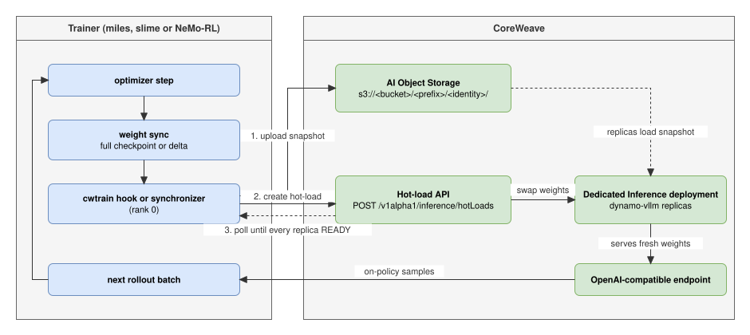

# Recipe: slime RL with rollouts on a CoreWeave hot-load deployment

Train with [slime](https://github.com/THUDM/slime) and serve rollouts from a CoreWeave Dedicated
Inference deployment. The deployment receives every weight update by checkpoint hot-load. The
trainer runs no inference engines:

1. After each sync, slime writes a versioned weight directory.
2. The `cwtrain` post-write hook uploads it and creates a hot-load.
3. The deployment swaps the weights in place on all replicas.
4. The next rollout batch samples the new weights through the deployment's OpenAI-compatible
   endpoint.



The same loop with miles, which needs no patch, is in [`../miles/`](../miles/README.md).

## Running it

Each example runs this recipe end to end on Kubernetes, with what you need, the steps and the
cleanup:

- [`slime-grpo-qwen3-4b`](../../examples/slime-grpo-qwen3-4b/README.md): GRPO on Qwen3-4B with the
  DAPO-Math-17k prompts.

An example's `run.env` holds the settings that this README names. This recipe's `k8s/` directory
holds the trainer Job (`trainer-job.yaml`), the script that the Job runs (`run-trainer.sh`), and
`make-kit.sh`, which bundles the cwtrain wheel, the recipe's scripts and its patches into the kit
ConfigMap.

## What slime needs that miles does not

slime expects to own SGLang engines. When none run, its `update_weights` returns early with "No
updatable SGLang engines are running; skip weight update". That also skips the disk-delta writer,
so the hook never runs.
[`patches/0001-standalone-delta-publish.patch`](patches/0001-standalone-delta-publish.patch) adds
`--update-weight-standalone-publish`. The flag:

- lets `update_weights` run the disk-delta writer with an empty engine list. The hook receives
  `rollout_engines=[]`, and every engine call is a no-op.
- skips slime's SGLang router when `--rollout-num-gpus 0`.
- removes the `--update-weight-local-checkpoint-dir` requirement, which applies only to slime's own
  engines.
- refuses NCCL transport, full mode, rollout GPUs and `--rollout-external-engine-addrs`, so no
  other sync path runs without its consumers.

Without the flag, slime's behaviour does not change.

### About the patches

The patches add what slime does not ship yet. They are not a second integration layer: the
`cwtrain` library carries no patches, and the miles recipe needs none because miles has the
standalone disk-delta path. The patches are small and stay in this recipe, so each one can go when
slime ships an equivalent.

| Patch | Size | What it changes | Needed when |
| --- | --- | --- | --- |
| `0001-standalone-delta-publish` | about 40 lines | adds `--update-weight-standalone-publish` as described above | always, until slime can publish deltas without its own engines |
| `0002-relax-numpy-check` | about 7 lines | lets slime's numpy 1 assertion be skipped with `SLIME_RELAX_NUMPY_CHECK=1` | only on images that ship numpy 2, such as the arm64 miles image |
| `0003-zero-kl-without-rollout-logprobs` | about 8 lines | shapes slime's zero KL from response lengths when a sample has no `rollout_log_probs` | only with `USE_TIS=0`, as a fallback when the endpoint's log-probs cannot be aligned with a batch |

The launcher (`launch.py`) applies the patches in order and checks each one before it applies it.
If a patch does not apply, the launcher reverts the patches it applied and stops the job. The
message names the tested commit, so a newer slime never starts half-patched. Patches that are
already applied are skipped.

### Tested versions

| Component | Version |
| --- | --- |
| slime | [`8ee9c1e1c`](https://github.com/THUDM/slime/commit/8ee9c1e1c8871ccd6dc8ec812edfaefa3dd1156b) (the default `SLIME_COMMIT`, checked out regardless of the slime the image ships) |
| Megatron-LM, when not taken from the image | [`1dcf0dafa`](https://github.com/NVIDIA/Megatron-LM/commit/1dcf0dafa884ad52ffb243625717a3471643e087) (the `MEGATRON_COMMIT` in the example's `run.env.example`), with slime's own Megatron patches |
| Trainer image | `radixark/miles` with `SLIME_RELAX_NUMPY_CHECK=1`; the example's `run.env.example` pins `radixark/miles:v0.1.1`, the release closest to the slime commit above |

A newer slime usually works if every patch still applies. The launcher tells you when one does
not. On slime's main branch, the code that patch 0001 touches is different. So the launcher moves
the official slime images' clone of main to `SLIME_COMMIT`.

`--rollout-external-engine-addrs` is not an alternative. It keeps the sync running, but slime then
calls each address's `/pull_weights` and `update_weights_from_disk` routes. A CoreWeave deployment
does not expose them.

## Configure the hook

Set these in the trainer workers' environment (rank 0 does the publishing):

```bash
export CWTRAIN_HOTLOAD_DEPLOYMENT_ID=<deployment uuid>
export CWTRAIN_HOTLOAD_RUN_ID=qwen3-4b-grpo-$(date -u +%Y%m%dT%H%M%SZ)   # unique per run
export CWTRAIN_HOTLOAD_FULL_EVERY=20                                    # the default; at most 64
export COREWEAVE_API_TOKEN=...
export AWS_ACCESS_KEY_ID=... AWS_SECRET_ACCESS_KEY=...                   # AI Object Storage
export AWS_REGION=<bucket zone>                                         # e.g. US-EAST-04A
```

Optional settings:

- `CWTRAIN_HOTLOAD_WAIT=0` stops blocking until the hot-load completes.
- `CWTRAIN_HOTLOAD_TIMEOUT` sets the hot-load timeout in seconds (default 1800).
- `CWTRAIN_HOTLOAD_VERIFY=1` re-checks every replica after each hot-load.

The hook's module docstring (`cwtrain/integrations/slime.py`) lists all its settings. In the
Kubernetes run, `run.env` sets these and the prompt-cache policy: `HOTLOAD_WAIT`,
`HOTLOAD_TIMEOUT`, `HOTLOAD_VERIFY`, `HOTLOAD_PROMPT_CACHE_POLICY`.

slime's `train.py` is synchronous: each rollout round samples the weights that the hook just
hot-loaded. So, unless you set it, the launcher sets
`CWTRAIN_HOTLOAD_PROMPT_CACHE_POLICY=reset_all`. This asks the platform to drop KV cache computed
under the previous weights, instead of reusing cached prompt prefixes across the swap. Set
`preserve` to keep the cache.

Either way, each rollout's requests carry a cache salt of the run, the rollout and a token drawn
once per process (`nvext.cache_salt`). A run resumed from a checkpoint repeats rollout numbers
under the same run ID, and the token keeps it from reusing the earlier process's salts. So a
prompt cached under earlier weights never serves a later rollout, even with `preserve`, as long
as the hook waits for every replica (`HOTLOAD_WAIT=1`, the default). With
`HOTLOAD_WAIT=0`, the rollout function logs a warning: a replica that has not switched yet would
cache old KV under the new salt.

Snapshot identities are `<RUN_ID>-vNNNNNN`. The platform keys weight versions by identity, so never
reuse a run ID for different weights.

## slime flags

```bash
python train.py ... \
  --rollout-num-gpus 0 \
  --rollout-function-path coreweave_rollout.generate_rollout \
  --update-weight-mode delta \
  --update-weight-transport disk \
  --update-weight-standalone-publish \
  --update-weight-disk-dir /work/deltas \
  --update-weight-delta-encoding xor \
  --update-weight-delta-checksum adler32 \
  --custom-update-weight-post-write-path cwtrain.integrations.slime.hook
```

Delta mode publishes zstd XOR deltas with Adler-32 checksums. This is the only delta format the
hot-load API accepts, and the hook rejects any other encoding or checksum before it uploads. Delta
mode does not work with `--colocate`.

[`coreweave_rollout.py`](coreweave_rollout.py) is the rollout function that slime imports.
`generate_rollout(args, rollout_id, data_source, evaluation)`:

- makes one `/v1/completions` request per GRPO group (`n` choices) to the deployment, through its
  gateway.
- sends the prompt as the token ids that slime trains on.
- takes the exact sampled token ids. It re-tokenizes the text only when the endpoint does not
  report them.
- scores the responses with slime's own `--rm-type`.
- gives every request its own random seed, so that replicas that start together do not sample
  alike (`CWTRAIN_ROLLOUT_SEEDS=0` turns this off).
- attaches the endpoint's sampled-token log-probs as `rollout_log_probs` when they align with the
  response tokens, including the token that ended the response. With `--use-tis`, a group where
  they do not align is sampled again, up to twice, before the rollout fails. Without it, they stay
  unset, and the trainer recomputes log-probs either way.

It is a thin slime adapter over `cwtrain.integrations.rollout`. Configure it with
`CWTRAIN_ROLLOUT_BASE_URL`, `CWTRAIN_ROLLOUT_MODEL` and, optionally,
`CWTRAIN_ROLLOUT_API_KEY_FILE`. The hook blocks until every replica serves the new version, so the
next rollout is on-policy without an engine handshake.

## Truncated importance sampling

The deployment and the trainer compute slightly different log-probs for the same tokens, so even
fresh rollouts are a little off-policy. The recipe passes `--use-tis`: slime weights each token's
loss by the trainer's probability over the deployment's, capped at 2 (`--tis-clip`). On a
Mixture-of-Experts model, combine it with routing replay (next section), which removes most of
the gap first. The [routing replay case study](../../case-studies/rollout-routing-replay/README.md)
measures the gap with and without replay.

- `USE_TIS=0` in `run.env` turns it off.
  A `run.env` written before this setting needs a `USE_TIS` line, because `render.sh` refuses a
  manifest that uses a variable the file doesn't set. `USE_TIS=1`, or an empty `USE_TIS=`,
  keeps TIS on.
- TIS reads `rollout_log_probs` from every sample. A group whose log-probs do not line up with
  its tokens is sampled again, up to twice, before the rollout fails. With the sampled token ids
  from the deployment, they always line up.
- Sample at temperature 1, the recipe's `--rollout-temperature`. The deployment reports log-probs
  before temperature and slime scores after it, so the rollout function refuses TIS at any other
  temperature.
- slime logs the weights as `tis`, the clipped share as `tis_clipfrac`, and the mean gap between
  the two log-probs as `train_rollout_logprob_abs_diff`.

## Routing replay for MoE models

On a Mixture-of-Experts model, the trainer's router can pick other experts for a token than the
deployment did. With `--use-rollout-routing-replay`, slime runs its MoE layers on the experts that
the deployment used, so it trains the forward pass that sampled the rollout. The rollout function
supplies them:

- Start the deployment with the `enable-return-routed-experts` engine option.
- Pass `--use-rollout-routing-replay` to slime. The rollout function then asks for each sequence's
  routes and stores them as `rollout_routed_experts`. The flag is the only switch: without it the
  rollout asks for no routes, and a `CWTRAIN_ROLLOUT_ROUTED_EXPERTS` that disagrees is ignored with
  a warning.
- A response carries one sequence's routes, so each group of `n` becomes `n` requests of one
  choice.
- A response without routes, or whose routes do not line up with its tokens or have another layer
  count or top-k than `--num-layers` and `--moe-router-topk`, fails the rollout. slime refuses to
  train a batch without routes in any case.
- The rollout runs slime's sample hooks (`--rollout-sample-hook-path`), so
  `slime.utils.routed_experts.spill_routed_experts` can move the routes to disk.

## Which entrypoint

slime ships `train.py` only. Its asynchronous training is the fully-async rollout worker
(`--fully-async`), which needs slime's own engines. This recipe does not cover it. The miles recipe
shows the one-step-ahead `train_async.py` variant.

## Concurrency

Same as the miles recipe: see [Concurrency](../miles/README.md#concurrency). The deployment's
`autoscaling.concurrency` caps the sequences each replica decodes at once (vLLM's
`--max-num-seqs`). `ROLLOUT_CONCURRENCY` in `run.env` sets how many group requests the trainer
keeps in flight. Each request asks for `--n-samples-per-prompt` completions.

## Sequence of one training step (delta mode)

| Step | Who | What |
| --- | --- | --- |
| baseline | slime rank 0 | Captures `--hf-checkpoint` bytes as the delta baseline and calls the hook with the delta root |
| baseline | hook | Publishes `--hf-checkpoint` as full snapshot `<run>-v000000`, unless a completed hot-load with that identity already exists; creates the weight mirror |
| sync N | slime ranks | Diff against the previous sync, write `weight_v00000N/` (shards + index with `base_version`) |
| sync N | hook (rank 0) | Apply the delta to the mirror and check every changed tensor's Adler-32; upload to `<prefix>/<run>-v00000N/`, create an incremental hot-load with predecessor `<run>-v00000(N-1)`, and wait until the hot-load completes (every replica READY on `<run>-v00000N`) |
| sync N, N % FULL_EVERY == 0 | hook (rank 0) | Same, but publish a **full** snapshot rebuilt from the mirror (with per-tensor checksums) so the chain restarts |
| sync N | slime | Barrier, then continues with the next rollout batch |

The hook blocks rank 0 before slime's barrier, so training pauses until the deployment serves the
new version. Set `CWTRAIN_HOTLOAD_WAIT=0` to give up that guarantee for more throughput.

## Full snapshots every N versions, and what is verified

Same as the miles recipe: see
[Full snapshots every N versions](../miles/README.md#full-snapshots-every-n-versions-and-what-is-verified).
The hook keeps a byte-exact mirror of the served weights, verifies every delta against the
trainer's Adler-32 checksums, publishes a checksummed full snapshot every `FULL_EVERY` versions,
and writes per-version checksum manifests. A COMPLETED hot-load means every replica serves the
new version. `CWTRAIN_HOTLOAD_VERIFY=1` re-reads the replicas anyway.

## Resuming a run

On restart, slime captures its baseline again, so the hook is called with the delta root again.
The hook looks for a completed `<run>-v000000` and skips the upload if it finds one. Version
numbers also restart at 1: slime clears the delta directory, and the deltas are again relative to
`--hf-checkpoint`. So a resumed run must publish under a *new* run ID. With the same run ID, the
hook would try to reuse identities that already exist with different bytes. Always start a
resumed run with a fresh `CWTRAIN_HOTLOAD_RUN_ID`.

## Pitfalls

- **`snapshot access check failed` at the start of the trainer Job means that the trainer may not
  use the hot-load prefix.** It needs `s3:ListBucket`, `s3:GetObject`, `s3:PutObject` and
  `s3:AbortMultipartUpload` there, from `AllowTrainer` and from its own org access policy. Check
  that `AllowTrainer` names the trainer's principal (`TRAINER_PRINCIPAL_ARN`), and that
  `HOTLOAD_PREFIX` is the deployment's `hotLoad.pathPrefix`. With Workload Identity Federation,
  also check that the cluster's issuer is registered and that the Job runs as
  `TRAINER_SERVICE_ACCOUNT`. `cwtrain hotload check --deployment <id>` runs the same check with the
  credentials of your shell.
- **The uploaded index names identities, not counters.** slime writes `000001` / `000000` as the
  index's `metadata.version` and `metadata.base_version`. The platform takes the delta's identity
  and its predecessor from the hot-load request, not from these fields. `upload_snapshot` still
  rewrites them to the snapshot identities during upload, so the index in the bucket agrees with
  the request. It uploads the shards and their per-tensor checksums unchanged.
- **A sync that changes nothing publishes nothing.** slime still writes `weight_vNNNNNN/` with an
  index and no shards. The hook logs it and reports `hotload/skipped_empty`. The skipped version is
  byte-identical, so the hook chains the next delta onto the last version the deployment received.
- **A replica that a failed replay left on `unknown` recovers on the next hot-load.** After a
  rejected delta, a replica can report weight version `unknown`. It stays paused until a later
  hot-load succeeds. Fix the cause, then create the hot-load again (see
  [Failure handling](#failure-handling)). `cwtrain hotload status <id>` shows each replica's state
  and error. If hot-loads still stall with `chain root unresolved`, the platform cannot tell which
  version a replica serves. The deployment's pods run on CoreWeave's side, so send CoreWeave
  support the deployment id and the hot-load's id.
- **A missing bucket policy is the most common reason weights fail to load.** The model download at
  deployment start and every hot-load read the bucket as the inference service account.

## Failure handling

Same as the miles recipe: see [Failure handling](../miles/README.md#failure-handling).

One symptom is specific to slime. If the log says `No updatable SGLang engines are running; skip
weight update`, the standalone-publish patch is not applied or `--update-weight-standalone-publish`
is missing. No hot-load is ever created.

## Verifying by hand

```bash
cwtrain hotload list --deployment <uuid>                 # newest first, with state
cwtrain hotload status <hot-load uuid>                   # replicas and their current identity
cwtrain hotload inspect /work/deltas/weight_v000003      # what the hook would publish
```

With the mirror on, `<delta dir>-hotload/manifests/<identity>.json` lists every tensor's Adler-32
for that version, which is what the engine's copy of that version hashes to. The bucket has the
same manifests under `<prefix>/_manifests/`.
